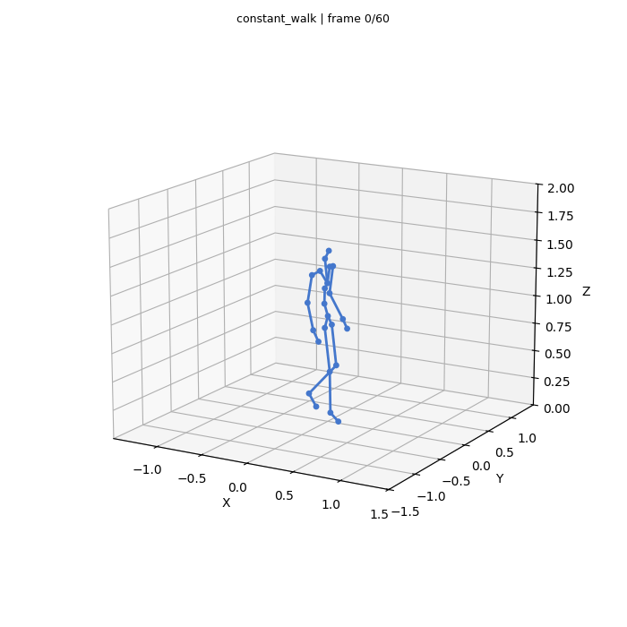

# Humanoid Motion Generation & Tracking

A conditional flow-matching model generates full-body humanoid motion from a
task phase, a desired heading, a goal position, and recent poses. It predicts
a short sequence of poses at a time. In Isaac Gym, Perpetual Humanoid Control
(PHC) tracks the first few poses, then feeds the humanoid’s measured state
back to the generator for the next prediction.



*Generator output for a constant walking command, before physics tracking.*

## How it works

The [generator](generation/examples/joint_flow/) learns to sample future
poses conditioned on motion history and the current command. The repository
includes two ways to use that history: self-attention over past and future
tokens, or cross-attention to past poses.

The [tracking task](tracking/phc/env/tasks/humanoid_im_mcp_demo.py) runs the
generator in the simulator process. Each humanoid keeps its own pose history;
the generator samples their next sequences in a batch. Switching feedback from
measured poses to predicted poses lets you compare how tracking errors affect
subsequent motion.

## Run

Follow the [setup guide](docs/setup.md) for dependencies and checkpoint
locations. Generation needs a phase-conditioned X16 checkpoint and its matching
normalization statistics. Live tracking also needs Isaac Gym, the PHC policy
weights, and SMPL assets.

```bash
# Check the active Python environment without loading the simulator.
python scripts/motion.py doctor

# Preview a phase-conditioned X16 checkpoint (best.pt + its stats.json).
python scripts/motion.py generate \
  --checkpoint generation/checkpoints/x16/best.pt \
  --stats generation/checkpoints/x16/stats.json \
  --motion constant_walk --seconds 5 --out outputs/walk.gif

# Track live generated references with the PHC runtime and assets installed.
python scripts/motion.py track \
  --checkpoint generation/checkpoints/x16/best.pt \
  --stats generation/checkpoints/x16/stats.json \
  --feedback robot
```

## Documentation

- [Generator architectures and training](generation/RESEARCH.md)
- [Motion representation and tracking interface](docs/architecture.md)
- [Validation results](docs/validation.md): generation and the flow adapter
  have been exercised on CPU; full physics playback remains unverified for
  this release.
- [Component credits and licenses](docs/attribution.md)
