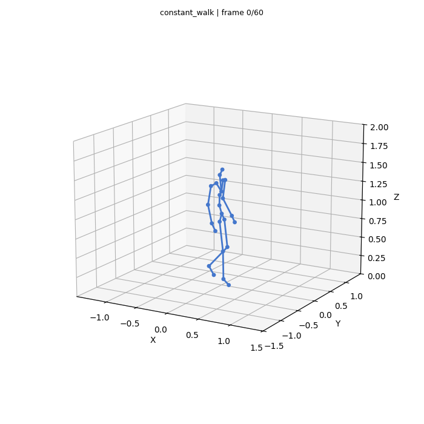

# Validation — 10 November 2026

These checks were executed against the consolidated source. Machine-readable
settings and asset hashes are in [validation.json](validation.json).

| Check | Result |
| --- | --- |
| Unified launcher integration tests | 7 passed |
| Imported generator library tests | 46 passed |
| Python syntax scan | 230 files parsed, no syntax errors |
| Generation dependencies | All detected in the validation runtime |
| Real checkpoint generation | CPU inference completed and saved a GIF |
| PHC flow adapter | Loaded the consolidated generator and sampled two streams; all values finite, shape `(2, 15, 76)` |
| Isaac Gym physics tracking | **Not validated**; complete PHC runtime and tracking assets unavailable |

## Generation smoke preview



This is an execution check with `joint_flow_x16c_cross_h15`, seed 0,
`constant_walk`, a two-second requested horizon, stride 5, and four ODE steps.
It generated 60 frames at 700×700. The inherited GIF encoder rounds 30 Hz
frames to 30 ms, so the displayed GIF duration is 1.8 seconds. This is a
kinematic skeleton preview, not a physics rollout or a tracking benchmark.

The source check scans for recognizable GitHub credentials/private-key
headers; it is not a comprehensive security audit. CPU tests do not validate
Isaac Gym compatibility, real-time inference, contact behavior, or manipulation.

## Reproduce the checks

From the repository root:

```bash
python -m unittest discover -s tests -v
python scripts/check_source.py
PYTHONPATH=generation python -m unittest discover -s generation/tests -v
python scripts/motion.py doctor
```

The first two commands need only standard Python. The generator tests require
the generation dependencies. To reproduce the animation, provide the matching
checkpoint and stats identified by hashes in `validation.json`, then use:

```bash
python scripts/motion.py generate \
  --checkpoint generation/checkpoints/x16/best.pt \
  --stats generation/checkpoints/x16/stats.json \
  --seconds 2 --steps 4 --stride 5 --seed 0 --device cpu \
  --out outputs/generation_smoke.gif
```

The quick-start live tracking path is restricted to phase-conditioned, 76D
humanoid checkpoints. Object-place X17 and older single-frame generator models
require their original research adapters and are not covered by these checks.
